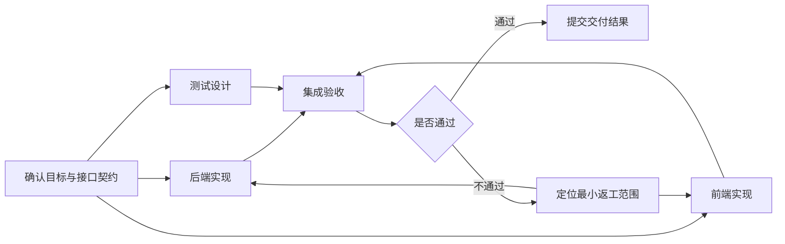

# 05 · 任务分解与依赖图

> 前置：04。目标：找到真正可独立执行的工作，控制交接与合并成本。

## 1. 拆分的对象是可验收责任

按“前端、后端、测试”分组容易理解，但领域标签本身不能保证独立。前端依赖接口，测试依赖行为标准，后端还可能修改共享数据。拆分时需要为每项任务明确输入、输出、所有权和验收，再检查边界之间的关系。

适宜粒度是一段能够独立判断结果、失败时能够单独重做的工作。过小会增加派发、上下文重复和等待；过大会使状态模糊、失败重做昂贵。粒度应结合执行时间、耦合程度和可检查性确定。

## 2. 表达依赖与就绪条件

图中的返工边表示可能需要修改，实际只重启受影响任务；测试设计本身有误时也应修订相应标准或用例。

| 关系 | 含义 | 示例 |
| --- | --- | --- |
| 数据依赖 | 必须取得上游结果 | 前端读取接口字段 |
| 控制依赖 | 满足条件才执行 | 验收通过才准备发布 |
| 资源约束 | 不能同时占用同一资源 | 共用唯一测试数据库 |
| 版本约束 | 输入必须来自兼容版本 | 客户端与接口契约版本一致 |

就绪不等于马上运行。任务可以满足依赖，但因预算、并发或权限等待调度。把等待原因分开，才能知道应该增加资源还是先完成上游。

无环依赖适合 DAG；返工和探索存在循环，可以用状态机或包含循环的图。循环需要退出条件和预算，否则“继续改进”没有终点。

## 3. 关键路径与并行收益

关键路径是决定完工时间的最长依赖链。增加非关键分支的 Worker，可能不会改变总耗时。

假设接口设计 20 分钟，前端 30 分钟、后端 40 分钟，集成 15 分钟。串行估计为 105 分钟；接口后并行估计为 75 分钟，再加协调和冲突成本。数字是教学假设，不是本项目测量结果。若前后端不断等待接口修改，并行优势可能消失。

## 4. 文件所有权和合并策略

多个 Worker 操作同一仓库有冲突风险，但不是必然冲突。应明确目录或文件所有权、共享接口负责人和合并顺序。可以使用隔离分支或工作区，再由收口者集成；隔离只能减少直接覆盖，不能消除语义冲突。

若多人必须修改同一核心文件，优先拆成串行变更或指定单一写入者。独立产物可并行生成，共享入口由集成任务修改。

## 5. 重规划与产物复用

新证据出现时，标记受影响任务，取消过时尝试，检查已完成产物是否兼容新计划。保留未受影响的工作，避免每次改计划都从零开始。计划变更应更新任务版本与验收映射。

**项目对应：**[通用协议](../../02-实操/skill-通用/SKILL.md) §2.2、§2.4 与 §4 已要求边界和依赖；机器可读任务图仍是后续建设方向。

## 6. 练习与验收

画出登录功能的任务图，标出接口、前端、后端、测试和集成；为每条边写明依赖类型。再加入“接口变更”，指出失效任务、可复用产物和新的关键路径。

[上一章](../01-基础与单体/04-目标任务与验收契约.md) · [返回导航](../README.md) · [下一章：组织结构](06-组织结构层级与能力匹配.md)
