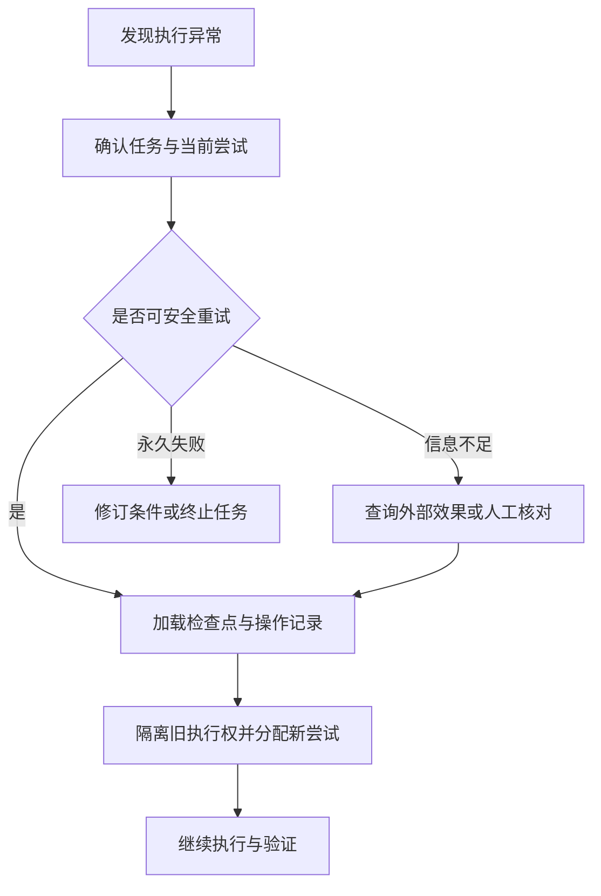

# 11 · 生命周期、故障检测与恢复

> 前置：07、09—10。目标：在不确定故障下恢复任务，并限制重复副作用。

## 1. 故障分类决定动作

| 故障 | 识别线索 | 合理处理 |
| --- | --- | --- |
| 进程退出 | 运行时确认实例结束 | 记录退出原因，再选择恢复点 |
| 通信中断 | 心跳过期但远端状态未知 | 标为疑似失联，管理执行权 |
| 工具临时错误 | 明确的限流或服务不可用 | 有上限的退避重试 |
| 永久错误 | 无权限、参数不合法 | 修正条件或上报 |
| 语义失败 | 产物不满足验收 | 返工、换方案或换能力 |
| 无进展 | 在线但长期无新证据 | 诊断、求助或终止尝试 |

“挂了就重启”跳过了两个问题：旧执行者是否仍在操作，以及新执行者从哪里继续。

## 2. 心跳、租约与执行代次

心跳表明最近响应过；租约描述某段时间内的执行资格。过期后可回收资格，但原进程可能仍然运行。因此重新分配时应增加代次或更换有效尝试 ID，由状态存储和写入接收方拒绝过期提交。

如果外部工具不校验代次，旧实例仍可能写入外部系统，需要幂等键、权限撤销、资源锁或人工处置等配合。只在任务表里换一个 owner，不能保护所有外部效果。

Kubernetes Lease 用于心跳及领导者协调，适合学习租约的系统角色；具体 Agent 写入保护仍需业务设计。[Leases](https://kubernetes.io/docs/concepts/architecture/leases/)

## 3. 恢复点与重试边界

这是逻辑设计顺序，具体平台可能把执行权回收安排得更早；恢复期间也应阻止旧尝试继续推进权威状态。

恢复时读取最后确认状态、已完成操作和产物，重新检查环境与授权，然后决定重试一步、恢复阶段、换 Worker 或重新规划。

检查点需要说明保存的是内存状态、图状态还是实际外部效果。恢复某个图节点不意味着该节点的所有外部操作都未发生。Temporal 的 Activity 文档强调幂等设计，可作为重复执行语义的参考。[Activity Definition](https://docs.temporal.io/activity-definition)

退避应有最大等待、次数和总预算，并可加入抖动，避免大量 Worker 同时重试。错误分类错误会放大故障：例如对权限拒绝持续重试没有恢复价值。

## 4. “已发生但没确认”的窗口

例如外部系统已经创建工单，Worker 尚未保存响应便崩溃。新实例若直接重新创建，会产生重复工单。

可选设计：使用稳定业务操作 ID 请求幂等创建；恢复后先按 ID 查询；在本地记录意图与外部引用；无法判断时进入人工核对。去重键应覆盖同一业务意图的重试，不能每次随机生成新键。补偿是新业务操作，并不保证完全恢复原状。

## 5. 协调者故障与故障演练

管理者的计划、分配、状态和待验收项也要持久化。接管者先确定自己具有管理权，再核对仍在运行的实例，避免批量重复派发。

演练至少覆盖：执行中杀进程、工具成功后丢响应、延迟旧提交、重复事件、协调者重启。记录检测耗时、恢复耗时、重复业务效果和最终验收结果。这里给的是实验方案，不是已经发生的项目事故。

## 6. 项目对应与验收

本项目已有静默失败、回到 shell、等待交互和配置漂移等经验，见[通用协议](../../02-实操/skill-通用/SKILL.md) §7。自动租约、幂等、检查点和协调者接管仍是设计目标。

**通过标准：**能够明确说明每个中断点的恢复位置、旧执行者处理方式及外部副作用核对方法，而不是只证明进程重新启动。

[上一章](10-编排调度与运行时.md) · [返回导航](../README.md) · [下一章：结果验收](12-结果合并与端到端验收.md)
